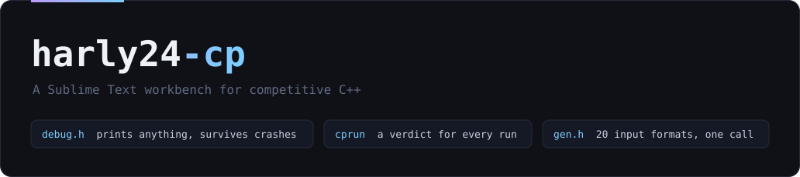
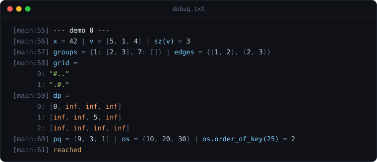
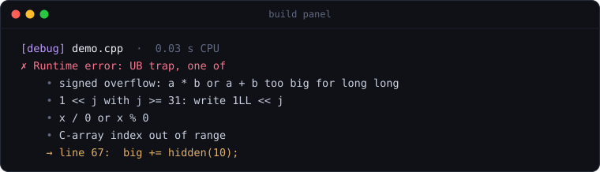
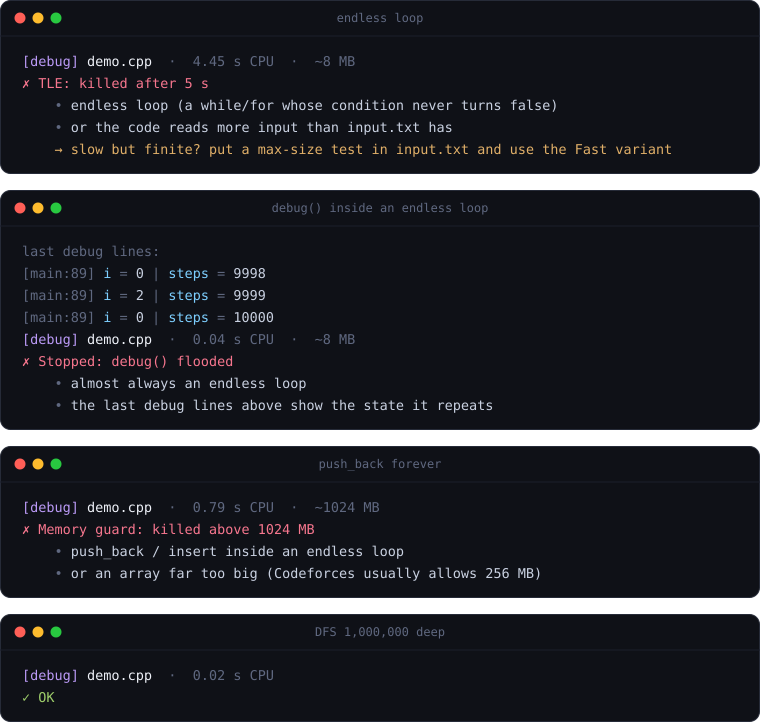
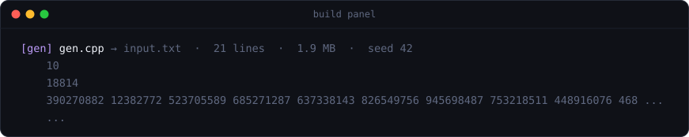

<p align="center">
  
</p>

<p align="center">
  <a href="https://github.com/Abhayanthk/harly24-cp/actions/workflows/test.yml"></a>
  
  
  
</p>

The setup I compete with on Codeforces as [Harly24](https://codeforces.com/profile/Harly24). One keystroke compiles your solution the way the judge does, runs it under guards, and tells you what went wrong and on which line. At its centre is `debug.h`, a debugger that prints whatever you hand it.

<br>

## debug.h

```cpp
debug(x, v, sz(v));
debug(groups, edges);                    // map<int, vector<int>>, set<pair<int, int>>
debug(grid);                             // vector<string>
debug(dp);                               // vector<vector<long long>> full of inf
debug(pq, os, os.order_of_key(25));      // priority_queue, pb_ds ordered_set
debug();                                 // "reached": where did it crash?
```

<p align="center"></p>

Debug templates usually stop working the moment a problem gets interesting. This one doesn't:

| | Typical debug template | debug.h |
| --- | --- | --- |
| `vector<set<int>>`, `map<int, vector<pair<int, int>>>` | compile error: an overload only sees the ones declared above it | any nesting |
| `set<int, greater<int>>`, a custom hash | no overload matches | any comparator, any hash |
| `multiset {1, 1, 2}` | often printed through a set: `{1, 2}` | `{1, 1, 2}` |
| `debug(f(a, b), mp[{1, 2}])` | names split at the inner commas | both names whole |
| `__int128`, C arrays, stack, queue, priority_queue | not printable | printed, without popping anything |
| the program crashes | buffered output is lost | every line is flushed first |
| `debug()` inside an endless loop | a multi-gigabyte file and a frozen editor | the run stops at 10,000 lines |
| `#define int long long` inside the header | `int` turns 64-bit locally and hides overflow | included before your macros |

On the judge, `debug(...)` compiles to nothing. Full reference: [docs/debugger.md](docs/debugger.md).

<br>

## cprun: every run ends in a verdict

Cmd+B compiles with the judge's compiler, GCC, plus checks the judge never gives you, then runs on `input.txt`. When the program dies, cprun reruns it once under the debugger and prints the line.

<p align="center"></p>

| Mistake | Usually | With cprun |
| --- | --- | --- |
| `v[n]` on a vector of size `n` | a random value, then WA | abort with the index and the size, plus the line |
| `a * b` overflows `long long` | a wrong answer | stops on that line |
| `1 << j` with `j >= 31` | a garbage mask | stops on that line |
| `x / 0` | returns 0 on Apple Silicon, crashes on the judge | stops on that line |
| a sort comparator using `<=` | runtime error on the judge only | abort, naming the comparator |
| DFS 1,000,000 deep | segfault on the default 8 MB stack | runs, like the judge's 256 MB |
| a missing `return` | undefined behaviour | compile error |

<p align="center"></p>

The four runs above used to freeze the editor or swap the machine. Each one now ends with a verdict: a time limit, a memory watchdog, a file-size cap, and `debug()`'s own flood stop. The time shown is CPU time, which is what the judge measures. Modes, verdicts and guards: [docs/cprun.md](docs/cprun.md).

<br>

## gen.h: any input in one line

```cpp
arrays(10, 200000, 1, 1e9);                  // 10 tests, sum of n = 2e5
trees(1, 200000, "line");                    // one long path: does the DFS survive?
weighted_graphs(0, 200000, 200000, 1, 1e9);  // a Dijkstra-size graph, no t line
update_queries(0, 200000, 200000, 1, 1e9);   // segment-tree input
```

Put one line in a file named `gen*.cpp`, press Cmd+B, and `input.txt` holds the test. Twenty common Codeforces formats are built in, all respecting the "sum of n over all tests" rule, plus the pieces to write any other format.

<p align="center"></p>

All formats and recipes: [docs/generator.md](docs/generator.md).

<br>

## Install

| | macOS | Linux, WSL |
| --- | --- | --- |
| Compiler | `brew install gcc` | `sudo apt install g++` |
| Crash line | `xcode-select --install` (lldb) | `sudo apt install gdb` |
| Editor | [Sublime Text 4](https://www.sublimetext.com) | Sublime Text 4 |

```bash
git clone https://github.com/Abhayanthk/harly24-cp.git
cd harly24-cp
./install.sh
```

1. In Sublime: **Tools > Build System > CP**.
2. Open `~/Documents/CPP/demo.cpp` (`~/cp` on Linux) and press **Cmd+B**. Change `DEMO` to see every verdict.
3. In a new `.cpp` file, type `CPP` and press **Tab** for the contest template.

Everything the installer creates is a symlink back into the clone, so `git pull` updates the whole setup, and anything it replaces is backed up to `~/.harly24-cp-backup/`. Options: `--workspace DIR`, `--with-prefs` (my font, theme and keymap), `--uninstall`.

<br>

## A contest with it

1. `CPP` + Tab. The template has `ordered_set`, `debug()` and a multi-test `main`.
2. Paste the sample into `input.txt` and press Cmd+B. `output.txt`, `debug.txt` and the verdict update together.
3. Close to the time limit? Write a max test in `gen.cpp`, then **Cmd+Shift+B > Fast**.
4. WA on test 2? `stressTesting` + Tab, add a brute force, then **Cmd+Shift+B > Stress**. It stops at the first input where the two disagree.

38 more snippets cover number theory, graphs, segment trees and bit tricks: [docs/snippets.md](docs/snippets.md).

<br>

## Under the hood

- **Any nesting.** `debug.h` has a single `print` template that dispatches with `if constexpr` on C++20 concepts: string-like, range, map, container adaptor, tuple-like, streamable. One template calling itself has no declaration order to get wrong.
- **About a second faster per build.** cprun keeps a precompiled `<bits/stdc++.h>` for each set of flags and rebuilds it when the compiler or the flags change.
- **Guards that work on macOS.** macOS ignores `ulimit -v`, so a small Perl watchdog forks the program, polls its memory, enforces the time limit and reads its CPU time back.
- **The crash line.** The program reruns once under lldb or gdb, from a scratch copy: on macOS a debugged binary loses the editor's folder permission and would ask for `~/Documents` access after every build.
- **Tested.** [tests/test.sh](tests/test.sh) runs 67 checks: every printable type, every verdict and its line, every generator format, every snippet inside the template. CI runs it on macOS and Ubuntu.

<br>

## Repository

```
harly24-cp
├── bin/cprun             compile, run under guards, explain
├── include/
│   ├── debug.h           the debugger
│   ├── gen.h             test generator
│   └── AllHeaders.h      what the template pulls in under -DLOCAL
├── sublime/              Sublime package, linked as Packages/harly24-cp
│   ├── CP.sublime-build  Cmd+B and its variants
│   └── snippets/         templates, math, graphs, data structures, arrays and strings, bits
├── preferences/          my editor settings (installed with --with-prefs)
├── workspace/            demo.cpp, gen.cpp and my contest checklist, copied on install
├── tests/                test.sh and its expected output
├── docs/                 reference pages, and the renderer behind every image here
├── legacy/               the five debuggers that came before
└── install.sh
```

The images in this README are not screenshots. [docs/tools/render.py](docs/tools/render.py) runs the demos through cprun and draws what they print.

<br>

## The road here

`debug.h` is the fifth debugger in this setup. The first, from November 2024, printed three container types and lost its output whenever the program crashed. Each version since fixed what broke the one before: [legacy/](legacy/README.md).

<br>

## License

[MIT](LICENSE)
