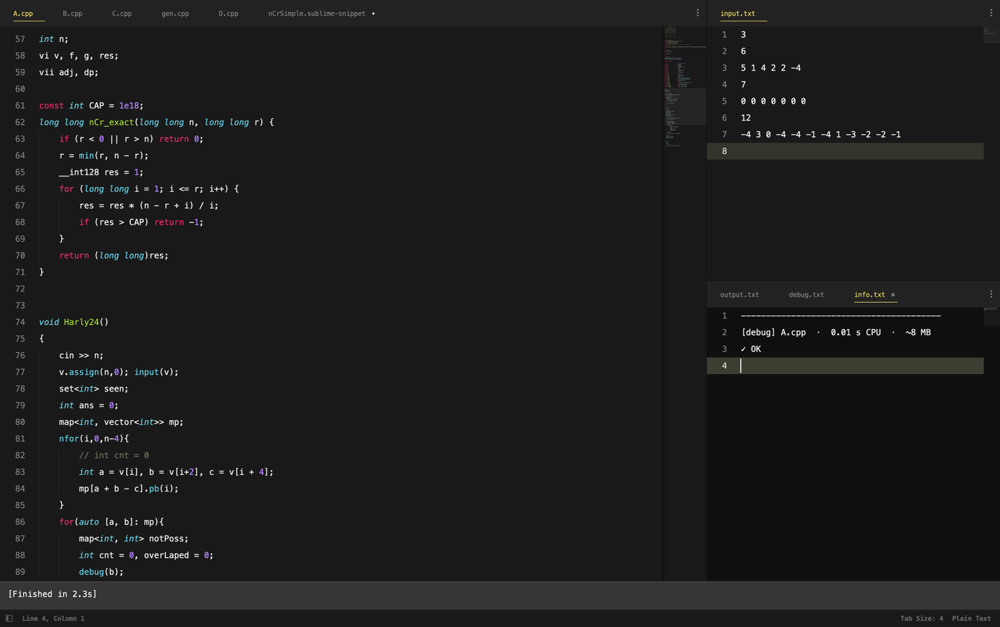

# Sublime Text

Code on the left. `input.txt` top right. `output.txt`, `debug.txt` and `info.txt` as tabs bottom right, with the verdict in `info.txt`. Every Cmd+B rewrites all three, and Sublime reloads open tabs on its own.

## Contest layout

Open the `.cpp` file you're solving, then **Command Palette > CP: Contest layout**. It splits the window as above and opens `input.txt`, `output.txt`, `debug.txt`, `info.txt` and `error.txt` from the same folder, creating any that don't exist yet. Sublime remembers the layout per window, so you set it once.

It lives in the package as [`cp_layout.py`](../sublime/cp_layout.py). Change `LAYOUT` there for other proportions.

## What the package installs

`install.sh` links [`sublime/`](../sublime) into Sublime's `Packages` folder as `harly24-cp`:

| File | Gives you |
| --- | --- |
| `CP.sublime-build` | Cmd+B and the Fast, Sanitize and Stress variants (see [cprun.md](cprun.md)) |
| `snippets/` | 40 snippets, listed in [snippets.md](snippets.md) |
| `cp_layout.py`, `Default.sublime-commands` | CP: Contest layout |
| `SublimeLinter.sublime-settings` | lints with the same GCC and C++23 as the build; plain `g++` on macOS is clang |

## My editor settings (`--with-prefs`)

Only with `./install.sh --with-prefs`. These replace your own Sublime preferences, keymap and mousemap (the old ones go to the backup folder), so skip the flag if you like yours.

| File | What's in it |
| --- | --- |
| [Preferences](../preferences/Preferences.sublime-settings) | JetBrains Mono 15 with 6 px line padding, Monokai Pro (Filter Spectrum) theme, Monokai Dark colours, highlighted current line, save on focus lost, trailing spaces trimmed on save, Vintage off |
| [Keymap](../preferences/Default.sublime-keymap) | Alt+↑ / Alt+↓ move the line, Alt+Shift+↑ / ↓ duplicate it |
| [Mousemap](../preferences/Default.sublime-mousemap) | Option-click adds a cursor |
| [Package Control](../preferences/Package%20Control.sublime-settings) | the packages the preferences expect: Theme - Monokai Pro, Monokai Dark, SublimeLinter with SublimeLinter-gcc, BracketHighlighter, All Autocomplete, SublimeAStyleFormatter |

The settings need the font and the packages:

1. Font: `brew install --cask font-jetbrains-mono` on macOS, or download it from [jetbrains.com/lp/mono](https://www.jetbrains.com/lp/mono/).
2. Packages: install Package Control (Command Palette > Install Package Control), copy `preferences/Package Control.sublime-settings` into `Packages/User`, and restart. Package Control installs everything on the list.
